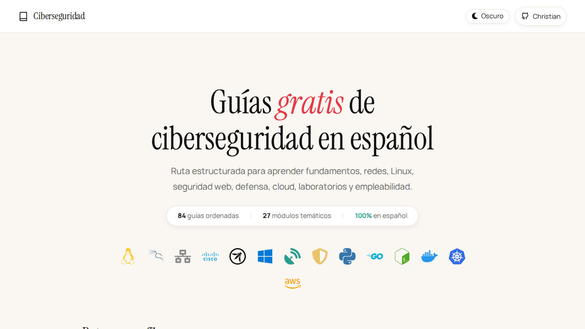

# Cybersecurity Learning Roadmap

Guias de ciberseguridad en español: estructuradas, practicas y gratuitas.

**→ [cbsdev.lat](https://cbsdev.lat)**



---

Hola, soy Christian Quiñones. Diseñé esta web para que cualquier persona pueda aprender ciberseguridad en español sin perderse entre recursos dispersos. Cada modulo tiene guias ordenadas, navegacion entre temas y rutas de lectura por perfil.

## Que Cubre

103 guias organizadas en 34 modulos:

- **Base tecnica** — computacion, sistemas operativos, identidad, riesgo.
- **Redes** — modelo OSI/TCP-IP, DNS, DHCP, NAT, VLANs, Cisco.
- **Linux y Windows** — fundamentos, Active Directory, permisos.
- **Programacion** — Python y automatizacion para seguridad.
- **Seguridad web** — HTTP, OWASP Top 10, SQL Injection, XSS, CSRF, SSRF.
- **Blue Team** — logs, SIEM, MITRE ATT&CK, Sigma, YARA, respuesta a incidentes.
- **Cloud Security** — IAM, storage, logging, Kubernetes, contenedores.
- **AppSec / DevSecOps** — API Security, GRC, privacidad, continuidad.
- **Redes avanzadas** — Wireless, Network Security, Endpoint, Database Security.
- **Practica** — Playbooks, labs guiados, capstones, writeups, empleabilidad.

## Por Donde Empezar

Entra a la web y sigue la ruta recomendada:

1. [cbsdev.lat/INICIO-AQUI](https://cbsdev.lat/INICIO-AQUI)
2. [cbsdev.lat/fundamentos/COMPUTACION-BASICA](https://cbsdev.lat/fundamentos/COMPUTACION-BASICA)
3. [cbsdev.lat/fundamentos/BASE-DE-SEGURIDAD](https://cbsdev.lat/fundamentos/BASE-DE-SEGURIDAD)
4. [cbsdev.lat/redes-cisco/FUNDAMENTOS-REDES](https://cbsdev.lat/redes-cisco/FUNDAMENTOS-REDES)
5. [cbsdev.lat/web-owasp/FUNDAMENTOS-WEB](https://cbsdev.lat/web-owasp/FUNDAMENTOS-WEB)

Ruta general:

```text
fundamentos -> redes -> Linux -> web -> Blue Team -> cloud/AppSec -> labs -> portafolio
```

## Etica

Todo el contenido es educativo.

Cualquier prueba, escaneo, explotacion o analisis debe realizarse solo en:

- sistemas propios;
- laboratorios locales;
- plataformas de practica autorizadas;
- entornos donde exista permiso explicito.

No uses este material contra terceros, redes publicas, empresas, usuarios o sistemas sin autorizacion.

## Contribuir

Las contribuciones son bienvenidas si respetan el enfoque educativo, defensivo y etico del proyecto.

Antes de proponer cambios, revisa [CONTRIBUTING.md](CONTRIBUTING.md).

## Apoya la Guia

Si esta coleccion te resulta util, considera dejar una estrella en GitHub. Ayuda a que mas personas encuentren el proyecto y a seguir mejorandolo poco a poco.

